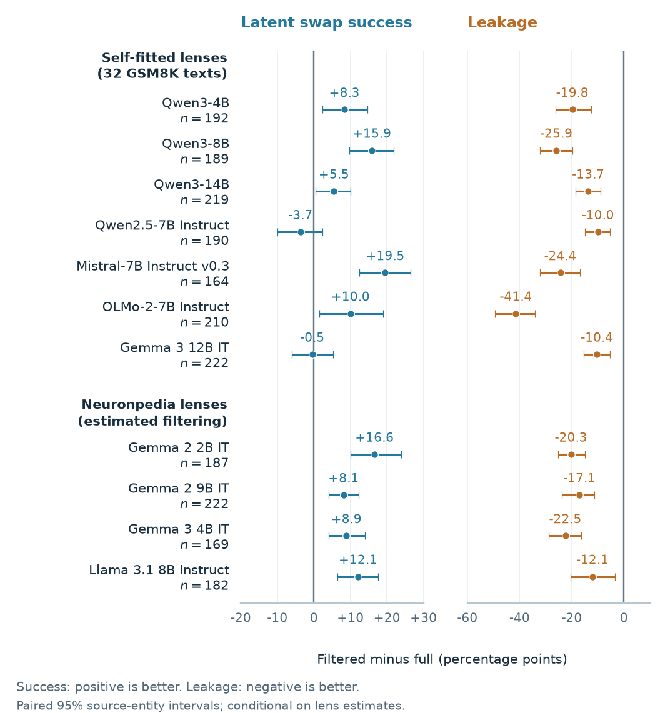

# Position-Pair Filtering Separates Concept Use from Name Leakage in J-lens Swaps

**Andy Xu, Claire Charles, Ankith Gundimeda, Ishan Nagpal, and Melwina Albuquerque.**
Accepted at ACCV 2026; proceedings details will be added when available.

This repository contains the research code and recorded evaluation outputs for
the paper. We test how a Jacobian lens's same-position and later-position
contributions affect concept-swap interventions. Across 16 model/lens conditions
on 13 checkpoints, filtering reduces name leakage at unit strength; downstream
accuracy gains depend on the model and task. Detailed mechanism experiments
focus on Qwen3-8B.

Subsequent work adds an expanded latent panel, loading/position analyses,
Gemma and Llama replications, and a Gemma pressure test. See the
[updated experiment map](docs/EXPERIMENTS.md#subsequent-experimental-work)
for their code, frozen protocols and data availability.

The [broader filtering replication](docs/FILTERING_REPLICATION.md) adds
Qwen3-4B/14B, Qwen2.5-7B, Mistral-7B and OLMo-2-7B, with a fresh Qwen3-8B
control.
A separate Gemma/Llama campaign keeps Neuronpedia's published full lenses fixed
and estimates the same-position contribution on WikiText; its filtering is an approximate
subtraction rather than an exact decomposition of the released fit.

The [complete core-results table](docs/results/full_table.md) combines the
original Qwen references and all completed model/lens replications, with
sample sizes, full/filtered rates, uncertainty and source provenance.
The [combined cross-model figure](docs/results/figures/cross_model_deduplicated.pdf)
shows one condition per model/size, using a documented source/variant display
rule; all 16 conditions remain in the table. Download
[the interactive HTML table](docs/results/index.html) to view it locally.



Self-fitted lenses use jointly estimated components on 32 GSM8K texts.
Published Neuronpedia lenses use a fixed released full lens minus a
same-position contribution estimated on 64 WikiText texts. This second
comparison is approximate and does not isolate lens source from differences
in fitting data and model-specific eligibility. The intervals condition on
one fit/estimate; they do not quantify repeated-fit variability.

## Start here

- [Reproduce the results](docs/REPRODUCING.md): offline verification, reports,
  figures, and GPU reruns.
- [Model card](MODEL_CARD.md): model, fitting data, interventions, intended use,
  evaluation, and limitations.
- [Paper-to-code map](docs/EXPERIMENTS.md): which experiment supports each result.
- [Paper audit](docs/PAPER_AUDIT.md): known discrepancies that require manuscript
  review before claiming exact reproduction of every printed number.
- [Protocol](docs/PROTOCOL.md) and [data provenance](data/README.md).

## Install and verify

Use Python 3.12 from the repository root. The exact environment used for the
release's CPU checks is recorded in `requirements/analysis-tested.txt`.

```bash
python -m venv .venv
source .venv/bin/activate
python -m pip install -r requirements/analysis-tested.txt
python -m pip install --no-deps -e .
python -m pytest -q
python scripts/release.py verify
python scripts/release.py restore
python scripts/reproduce.py tables
python scripts/publish_results.py verify
```

The default tests exclude network/model-download tests. The bundled reference
artifacts are losslessly compressed raw outputs and required fitted directions,
with checksums. Restoring them requires about 288 MiB. It does not download a
model, run a GPU, or contact a cloud account. Differing existing results are
never overwritten. The expanded reference manifest also includes the saved
cross-model trial outputs and all data inputs for the combined results table.
See [release verification](docs/VERIFICATION.md) for the tested scope.

To rebuild the cross-model table and figures from those recorded runs:

```bash
python scripts/release.py restore
python scripts/75_all_core_results.py
python scripts/76_core_results_figures.py
python scripts/publish_results.py verify --rebuilt
```

Generated files go to the ignored `output/core-results/` directory. The checked-in
public snapshot lives in `docs/results/`; maintainers update it with
`python scripts/publish_results.py build` after checking new outputs.

For a flexible dependency install instead of the tested pins, use
`python -m pip install -e '.[dev,analysis]'`. Numerical agreement with the tested
environment must then be checked. See the reproduction guide for GPU hardware
and dependency provenance limits.

## Repository layout

| Path | Contents |
|---|---|
| `src/jsteer/` | Jacobians, position-pair decomposition, steering, grading, corpora and experiment runners |
| `configs/` | Model dimensions, loading revisions and workspace bands |
| `data/heldout/` | Frozen evaluation definitions |
| `data/protocols/` | Frozen latent-panel design |
| `data/reference/` | Checksummed, compressed inputs and trial-level outputs used by the paper |
| `scripts/reproduce.py` | CPU reproduction entrypoint |
| `scripts/run_paper.py` | Local experiment plans and GPU execution |
| `scripts/` | Original numbered experiment/report entrypoints; [catalog](docs/SCRIPTS.md) |
| `tests/` | Small-model and mathematical correctness checks |
| `modal_app.py` | Optional remote execution; requires your own Modal account |
| `modal_replication.py` | Optional cross-model campaign launcher; no cloud jobs run during installation or CPU reanalysis |
| `docs/results/` | Curated public table, figures, plotting data and provenance |
| `results/`, `output/` | Generated files; ignored by Git |

The numbered scripts retain their names because run provenance and analysis
imports refer to them. Older exploratory experiments are identified in the
catalog and are not evidence for cross-model claims in this paper.

## Source release

```bash
python scripts/release.py audit
python scripts/release.py archive
```

This creates `dist/jlens-steering-camera-ready.zip` from an explicit inclusion
policy, with fixed archive timestamps and file checksums. It excludes Git
history, drafts, manuscripts, logs, credentials and local working notes. A
public repository's owner, authors and existing history are identifying. This
camera-ready release is de-anonymized. The full source/reference archive exceeds
the conference's supplementary-file limit; it is a code-host distribution, not
a ready-to-upload conference supplement. See [release notes](docs/RELEASE.md).

## Citation

Author information is available in [CITATION.cff](CITATION.cff). Until the
proceedings record is available:

```bibtex
@misc{xu2026positionpair,
  title = {Position-Pair Filtering Separates Concept Use from Name Leakage in J-lens Swaps},
  author = {Xu, Andy and Charles, Claire and Gundimeda, Ankith and Nagpal, Ishan and Albuquerque, Melwina},
  year = {2026},
  note = {Accepted at ACCV 2026},
  url = {https://github.com/axmi-28/AlgoverseSU26-Jlens-Steering}
}
```

Original code: [MIT License](LICENSE). Third-party data, models and dependencies
retain their [upstream terms](THIRD_PARTY_NOTICES.md).
